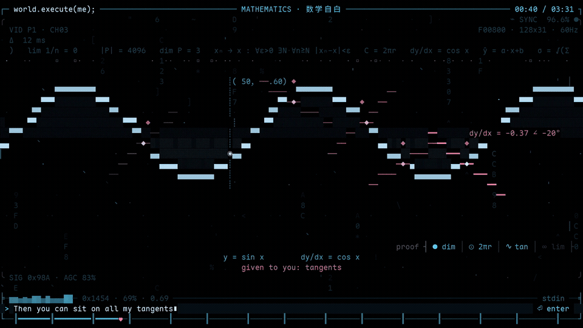

# world.execute(me); — 终端 ASCII 字符动画 MV

用 ANSI / ASCII 字符在终端里播放的一支 MV：Mili《world.execute(me);》
（专辑 *Miracle Milk*, 2016）。画面全部由字符、色块和转义序列实时渲染，
英文歌词在画面里的输入行中逐字打出，中文歌词在画面外的最下一排淡入；
节拍与歌词时间戳驱动每一个转场。



> 成片（1920×1080 / 30 fps / 3:31.9）在 [`out/world-execute-me_16x9_1080p.mp4`](out/world-execute-me_16x9_1080p.mp4)，
> 只想看播放效果可以直接下这个文件。

```
./run.sh
```

---

## 快速开始

```sh
./run.sh                 # 有声音播放（自动找 assets/ 里的音频）
./run.sh --silent        # 只看画面，不要声音
./run.sh --info          # 打印时间轴（BPM、分段、86 行双语歌词时间戳）
./run.sh --dump 15,96    # 把指定秒数的画面渲染成纯文本，便于截图/调试
./run.sh --help          # 全部参数

python3 src/video.py     # 同一条时间轴渲染成 16:9 的 1920×1080 MP4（out/，约 3 分钟）
```

**终端要求**：最小 `48x14`，推荐 `100x30` 以上（越大画面细节越多）。
支持真彩色（`COLORTERM=truecolor`）、256 色、以及纯单色终端（`--mono`）。

**依赖**：

| 用途 | 依赖 | 缺失时 |
|---|---|---|
| 运行 | Python 3.8+（只用标准库） | — |
| 音频 | `mpv`（首选，Unix socket IPC 精确对时） | 自动降级 |
| 音频备选 | `ffplay` / `mpg123` / `paplay` | 用系统时钟对齐 |
| 无声 | — | `--silent` 或找不到音频时自动静音播放 |
| 音频转码（仅首次） | `ffmpeg` | 已提供 `assets/world-execute-me.m4a`，无需再转 |
| 导出视频（可选） | `ffmpeg` + Pillow（`python3 -m pip install pillow`） | 不导出就不需要 |

## 操作

| 键 | 作用 |
|---|---|
| `空格` | 暂停 / 继续（音频与画面同时暂停） |
| `←` / `→` | 后退 / 前进 5 秒 |
| `↓` / `↑` | 后退 / 前进 30 秒 |
| `q` / `Esc` / `Ctrl-C` | 退出（恢复终端、关闭播放器） |

## 命令行参数

```
--silent            无声播放
--fps 20            渲染帧率（默认 20，最低 4）
--start 60          从第 60 秒开始
--audio PATH        指定音频文件
--player mpv_ipc|mpv|ffplay|mpg123|paplay|silent
--volume 100        音量
--color auto|rgb|256|mono    色彩模式
--mono              强制单色
--width / --height  强制画布尺寸（默认跟随终端）
--offset 0.25       字幕整体偏移（秒），用于微调对轴
--no-hud            不画边框、进度条与副标题区
--info              打印时间轴
--dump 15,60,96.5   渲染指定时间点的静态帧
--dump-size 100x30  dump 的画布尺寸
```

---

## 第 11 版 · 输出成视频（16:9 MP4）

想在电视 / 投影 / 剪辑软件里放，就把同一套画面渲成像素，再交给 ffmpeg：

```sh
python3 src/video.py                    # → out/world-execute-me_16x9_1080p.mp4（3:31.9）
python3 src/video.py --preview 42,155   # 先出几张 PNG 看效果（out/preview_*.png）
python3 src/video.py --start 40 --end 60 --out out/00-40-60.mp4   # 只渲一段
python3 src/video.py --zh --out out/world-execute-me_16x9_1080p_zh.mp4   # 连中文字幕一起渲
```

**中文字幕默认不在成片里**。画面外那行中文是网格的第 32 行，31 行的 16:9 画面塞不下，
所以默认成片只有画面内的英文，开场标题卡据此写「英文字幕 · 与歌同步」而不是「中英双语字幕」。
要连中文一起，加 `--zh`：网格变 32 行（从画面里让出一行给中文字幕，`h_canvas = ROWS - 1`），
32 × 34 = 1088 px 上下各裁 4 px 留白 —— 仍是 **1920×1080、格子仍是 15×34**，字还是没拉伸；
这时标题卡自动换回「中英双语字幕 · 与歌同步」。开关就是 `src/opts.py` 里的 `opts.ZH`。

**画面就是终端那幅画**，不是另画一版：`src/video.py` 调的是播放器同一个
`mv.compose()`，一格字符 = 一个格子，逐格贴到像素上（背景色块 → 字形，宽字符占两格、
转角 `╭╮╰╯` 的 1 px 出格保留，所以横竖线是连着的）。

| 项 | 值 |
|---|---|
| 画幅 | **1920×1080（16:9）** |
| 网格 | 128 列 × 31 行，每格 15×34 px（= 1920×1054，上下各补 13 px 黑边）；`--zh` 时 32 行 |
| 帧率 | 30 fps（6354 帧） |
| 编码 | H.264 `yuv420p` / CRF 18 / high@4.1，AAC 44.1 kHz 立体声原音轨，`+faststart` |
| 时长 / 体积 | 3:31.9 / 84 MB |
| 渲染速度 | ~34–37 fps（16 核约 3 分钟渲完） |
| 字幕 | 默认只有画面内英文；`--zh` 才带上画面外那行中文（标题卡随之改字） |

- **字体**：Maple Mono NF CN（等宽 + Nerd 图标 + 中日韩），25 px 时字宽正好 15 px、
  行高 34 px —— **格子和字体的原生格一致，字没有拉伸**；它缺的 35 个符号自动落到
  JetBrains Mono / DejaVu / Noto CJK（开渲前探测一遍，结果缓存在 `.cache/fontmap.json`）。
- **验收**：从成片里按帧号解码回 4 帧（t=42 / 120 / 155 / 205.9），与直接渲染的参考帧
  逐像素比对 **PSNR 35.8–43.9 dB**（CRF 18 + 4:2:0 的正常损耗，肉眼无差）；全片平均亮度
  18.5–30.9，没有空帧；第 10 版的 ∞ 缺口在成片里仍是**全黑的一格不剩**（逐格采样 ink=0）。
- **改尺寸**：`src/video.py` 顶部 `COLS / ROWS / CW / CH` 四个常量决定网格与格子的像素；
  `CW=15, CH=34` 是那套字 25 px 的原生格，改字体会连带改这两个数。`OUT_W/OUT_H` 保持
  16:9 即可（多出来的高度会均分成上下黑边）。

---

## 目录结构

```
.
├── run.sh                       启动器
├── assets/world-execute-me.m4a  工作用音频（从原 mp4 抽出 AAC，3:31.9）
├── out/world-execute-me_16x9_1080p.mp4  导出的 16:9 成片（1920×1080, 30 fps, 84 MB）
├── doc/prompt-history.md        提示词纪要：35 轮要求逐条记录（你要什么 → 改了什么 → 结果）
├── doc/preview.gif              README 顶部那段 5 秒预览（成片 0:40 的 ∞）
├── __backend/Cli/original_assestss/  最初上传的原始素材（Mili 的 mp4 + lrc + m4a，未改动）
├── __backend/V1 … V8/          历史版本快照（每版各自的 README / run.sh / src / assets）
├── LICENSE                      MIT（只覆盖代码）
├── NOTICE                       歌词 / 音频 / 原始影像的版权说明
├── README.md
└── src/
    ├── mv.py          主循环、场景调度、边框/进度条、输入行与中文行、CLI
    ├── renderer.py    画布 Canvas 与输出 Emitter：宽字符安全写入、对齐/混色、配色量化
    ├── lyrics.py      130 BPM 网格、15 段结构、86 行双语时间轴
    ├── audio.py       三级播放器：mpv IPC → 管道播放器+时钟补偿 → 静音
    ├── energy.py      音频 RMS 包络（20 Hz），驱动画面随响度呼吸
    ├── art.py         5x5 字体、机器人 ME、YOU 菱形、猫、神、骷髅等素材
    ├── fx.py          雨、星场、扫描线、故障、波纹、示波器、均衡器等特效
    ├── crt.py         CRT 信号层：磷光点阵、数据流、扫描亮带、色散、失步、
    │                  掉帧、过曝、角落遥测（叠在每一帧之上）
    ├── base.py        场景基类、时间窗淡入淡出、溶解叠化 stamp
    ├── anim.py        动画语法四个动作 8 个原语（build / morph / track / hand）
    │                  ＋ 全片共用件 pulse_bars / flow / brackets / dial /
    │                  hexrow / scanline / ticker / type_loop / echo_row
    ├── obsess.py      输入行的「执念」层：同一句英文可以重复打、删了重打、
    │                  `[only]` 记号——都只是 t 的函数，不碰时间轴
    ├── video.py       导出视频：同一帧画成像素、管道喂给 ffmpeg → 16:9 MP4
    │                  （`--zh` 把画面外那行中文字幕也渲进去）
    ├── scenes_a.py    Intro / Verse1 / Verse2 / Pre1 / Chorus1
    ├── scenes_b.py    Verse3 / Pre2 / Chorus2 / Bridge / Build
    └── scenes_c.py    Chant / Final / Outro / Shutdown / EndCard
```

一次次的改动从哪来、每一轮要求是什么，记在 [`doc/prompt-history.md`](doc/prompt-history.md)。

---

## 同步是怎么做的

画面 **不是** 预渲染视频，而是每一帧都由当前播放时间 `t` 纯函数式地画出来
（所有随机量都来自 `h01(seed...)` 哈希，所以同一时刻永远画出同一帧，拖动进度
条也不会花屏）。

对时有三个层级，自动选择：

1. **mpv + Unix Socket JSON IPC**（首选）
   以 `--input-ipc-server` 启动 mpv，每帧 `get_property time-pos` 读真实播放
   位置，`pause` / `seek` 直接作用于播放器。画面跟着音频走，不可能漂移。
2. **管道播放器 + 单调时钟 + 启动补偿**
   `mpv --no-video` / `ffplay -nodisp` / `mpg123` / `paplay` 播放，用
   `time.monotonic()` 计时，并按各播放器的启动延迟（mpv ~0.22 s、ffplay
   ~0.42 s、mpg123 ~0.18 s、paplay ~0.12 s）补偿首帧偏移。
3. **静音**：`--silent` 时用同一个时钟驱动，画面依然完整。

**节拍**：对音频做 10 ms 跳步的自相关 + 抛物线插值，锁定 **130.0 BPM**
（一拍 0.4615 s，一小节 1.846 s）。鼓点、心跳、故障闪烁、进度条刻度都对齐
到这个网格。

**歌词时间轴**：逐句时间取自这首歌**专辑版的官方同步歌词**（时长 3:31.9，与
`assets/` 里的音频等长），并用音频本身复核过。有两件事容易搞错，而它们正好
决定了"对不对得上嘴"：

1. 这首歌**没有前奏**——第一个字 "Switch on the power line" 在 **0.10 s** 就
   唱出来了（音乐盒伴奏、人声很轻），完整的乐队要到 **15.00 s** 才砸进来。
   所以 0:00–0:15 不是"开机动画垫在无歌词的引子上"，而是**第一段主歌整段**：
   开机自检的动画直接铺在这段人声上。
2. 0:15.0–0:29.7 才是器乐段（里头 16.0 s 有一句 `world.execute(me);`），
   随后 0:29.7 进第二段主歌。

`--offset` 可再整体微调（例如外接蓝牙音箱有延迟时）。

---

## 动画语法：每一拍都是 build → morph → track → hand

整部片子没有「切到下一张画面」这回事。每一拍都由四个动作组成，`anim.py` 把每个
动作做成一个原语，所有场景共用同一套语法：

| 动作 | 原语 | 在画面上的意思 |
|---|---|---|
| **build** | `assemble` `type_lines` `sweep` `rise` | 东西是**被造出来**的：字符从散点被拉回原位、一行行打出来、一条线被针尖描出来、一根柱子长上来 |
| **morph** | `dissolve` | 刚才那个东西**变成**下一个东西：逐格阈值翻转（不是两张图叠在一起半透明），接缝处炸出 `▒ ░`，所以眼睛读到的是「这个变成了那个」 |
| **track** | `ladder` `meter` `counter` | 变化的同时有**仪表在数**：阶梯上第几行亮 `▸`、进度条从 0 到 100%、计数器在跳 |
| **hand** | `hand_off` `dissolve_canvases` | 一拍结束不是淡出，是**碎掉**：画面被斑点状前沿吃掉，下一拍从这些洞里建起来 |

三个贯穿全片的决定：

1. **场景交接也是 morph**。`mv.render_scene` 原来用 alpha 交叉淡化，两段画面会
   同时半透明可见（一秒多的时间里新旧内容叠在一起，最难看的地方）。现在换成
   `anim.dissolve_canvases`：旧的整幅画面被逐格吃掉、新的从洞里填进来，中间还有
   `▒ ░` 的裂口——所以段落之间是「撕裂」，不是「溶化」。
2. **纯函数**：所有动画都只由 `t` 和 `h01(...)` 哈希决定，没有帧间状态，所以
   暂停、拖动、跳段都停在同一帧；`--dump` 出来的图和终端里跑的一模一样。
3. **小终端也守规矩**：终端入口要求 48×14（再小会直接提示退出），但直接从 `compose()`
   调 40×12 也不崩、48×14 不糊，面板在矮屏自动降级成单行读数。

`anim.py` 里的原语都遵守片子的排版约定（不画 0–3 行的遥测区、不在最后两行落笔、
面板里的文字必须带 `bg=`），所以新加一拍时只需要挑动作，不用重新踩一遍坑。

**「静帧段」全部改成动画**（第 3 版起，凡是同一画面停留超过 1 秒的地方都补上了动作；
下表的「现在」是当前代码的样子）：

| 位置 | 原来 | 现在 |
|---|---|---|
| INTERLUDE 0:15–0:29 | 一个静态背景 + 一块面板 | 上面那 8 拍，地形/城市/电线/棋子/罩子/机器人/面板/仿真依次 build，仪表一路在数 |
| VERSE 2 圆（0:33） | 上一张画面淡出后空一拍，圆才开始画 | 圆**先以暗点全周存在**（形状已知），亮头再沿周长描一遍，半径臂跟着扫、`θ 000°` 在数；两拍**交叉重叠**（旧的还在淡出，新的已经开画），没有空窗 |
| VERSE 2 ∞（0:41） | 双纽线画完就不动了 | ∞ 由一颗颗 `•` 改成**一条细线**（斜/横/竖/转角字形逐格排出来、左右严格镜像），笔画上**永远少一小截**——一小段缺口（100×30 上 5 格）沿着环路 3.1 s 走一圈，全程没有一个更亮的格子；点列不再上下摆动，改成**往左流的传送带**（漏斗形状不变、点一直在走），`|x_n − x|` 读数从 0.04 掉向 0 |
| PRE 1 盲/眩（0:48） | 闭眼后屏幕几乎全空，静止约 4 秒 | 视野崩成**整屏闪烁的横条**（逐行相位错开）+ 6 臂星芒以 7–13 rad/s 旋转 + 三圈涟漪向外扩，`so dizzy . . .`、`blind 100%  θ 000°` 实时计数 |
| VERSE 2 点/线/面/体（0:33） | 图是画出来的，但图本身是静的 | 顶部只有一路**活点采样**（13 Hz 重抽的 `· ∙ ▫`）——「函数一直被测量」，但不放任何横着扫过公式的条带：**没有从上而下的整屏扫描，也没有贴着画面上沿往左跑的示波条**，0:29–0:48 这段是唯一要求「公式必须看得清」的地方 |
| INTRO 尾部（0:12） | 自检清单写完后整屏静止 | `0x4000` 写满后**读指针继续扫**：右栏内存转储以 190 B/s 滚动、地址列跟着走、底部 `read XXXXX` 在跳 |
| VERSE 3（1:14） | 四段各自独立的静帧，礼物只是几颗同一个粒子在飞 | 四句歌词就是四次「如果我是什么，我就给你什么」，所以舞台改成一台 **if/then 求值器**：精灵头上 `IF   me := "eggplant"` 逐字打出，等 `THEN grant(you) := nutrients` 出现才执行；**每种礼物用不同机制送到 `you`**——茄子是身体被**抽干**（`▁` 液面往上收、掉出的质量沿弧线飞进菱形，`fed 246 u`）、番茄是**在你身上长出护盾**（双层 `○` 环，`✳` 自由基撞上来变成 `+` 死掉，`shield 100% blocked 22`）、花猫是**呼噜成环**（`~` 弧一路推到 `you`，菱形跟着声波上下抖 1 格，`enjoy +95`）、唯一的神则**反向**：传送带倒着走、`◈` 从 `you` 飞回我，`existence 0→1.0`、`WITNESS`、`∎ QED`。`grant.table` 面板保留，但第 4 行的箭头翻成 `4 only god ← proof`；底部 `state 0N/04 …` 每拍跟着换读数 |
| CHORUS 2（1:43） | 心与完成度是静态图 | 两半心 `assemble` 拼合、缝隙从 9 格收到 0（9.3 Hz 抖动）在 107.903 合缝；五条带子逐个被拆、`vibration.monitor` 双表＋两路 ECG＋频率读数、`isolation` 只剩一个点和一条平线 |
| BRIDGE（1:58） | 巨神是静止剪影 | 巨神周围有落下的 `✦` 与见证光束；问神的那一拍**整幅画面在抖**（`row_wave` ±1 格）＋ glitch，`FATAL: argument 'me' is not accepted by god()` 逐条刷出来 |
| PRE 2（1:28） | 配置面板改完就定住 | 滑杆与巨字 `F⇄M` 在切换完成后**继续来回摆**（机器拿不定主意），时间带上的 `▼`／`☼`／`☾` 跟着钟点走、星星按夜色调亮度 |
| FINAL（2:42） | 4096 个目标在刷 KILLED，但标记很稀 | 顶部两行**吞吐监视**：红色滚动条形波形（24 格/s）＋每帧重抽的 `†`／`✕` 散点（11 Hz），配整幅扫描头与抖屏，「唯一的那次执行」是在被观测中跑完的 |
| OUTRO（2:57） | 三张卡片基本不动 | 笔记 / 试卷 / 代数式三张卡都在动：`studied` 进度条、考场倒计时、答案逐字打＋`✓`；末尾一条**心跳示波线**在滚（`vitals · 1 heart · 130 bpm · still here`） |
| SHUTDOWN（3:11） | 退出日志一屏字 | 进程表 RUN→TERM→exited 三拍错开、释放内存计数到 8192 KiB、笼子栏杆收回；长暗里还有呼吸的 `▮`、往下爬的磷光带、`...execution.` 在 205.811 闪白 |
| END CARD（3:27） | 静态卡 | 噪声场里把 `world.execute(me);` 拼出来（`assemble`）、六角噪声 8 Hz 重写、uptime 数到 03:31.9、`$ exit 0` 打字、字幕逐行打出，最后挤压成一条亮线→一个点 |

用 0.4 s 滑窗逐段扫过一遍（15 段 × 6 种尺寸），**没有任何一段出现「静止超过 1 秒」的窗口**；
唯一故意静下来的是 EndCard 最后一帧（CRT 收成一个点之后）。

---

## 15 个段落与画面

| 时间 | 段落 | 画面 |
|---|---|---|
| 0:00 | VERSE 1「Switch on the power line」 | **开机自检**：电压表从 0 爬到 220V、电闸合上 → 歌名被炸成乱码再逐字重组锁定（`SYNC 12/18 → LOCK 18/18`）→ 歌词自己的字节流灌满屏幕、读头在转储里一路找到 `you`（0x796F75）并闪亮地址 → 15 项初始化逐项检测，`memory` 面板持续滚动不熄（整段垫在主歌底下） |
| 0:15 | INTERLUDE「world.execute(me);」 | **世界从零被搭出来**（8 拍，同一套语法）：地面长出 `┼` 交叉点与滑动的 `▪` 数据包 → 天际线拔起、窗户 `▪` 逐扇点亮并实时计数（`windows n/128`）→ 输电线 `╪` 塔一路立过去、电流 `◉` 脉冲奔向城市 → 棋子落下、`♜` 吃子带坐标 → 机器人被从散点**组装**（眼睛脉冲、胸口 ECG 待机）→ 初始化面板逐行 `✓`、`love ▕████▏ 1.00` → `SIMULATION START`、`◆ "you"` 绕它转、地面滚着歌名字幕带 |
| 0:29 | VERSE 2「dim(P)=3 / C=2πr / ∞」 | 点云被 `you` 一层层给出维度（`dim(P) 0→3`）、`|P|` 一路数到 4096、**最小二乘回归线穿过点云**（逐点残差 `|`、σ 读数，残差在立方体成形前完全退场）；回归线完成后**平面就地挤出成一只实心盒子**：正面（原来的那张平面）`─│` 冰蓝最亮、顶面 `·` 点阵受光、右面 `·` 点阵转暗背光，三条明度台阶 + 收敛棱边 + 只画可见面（隐藏棱不画）——所以它看起来是**块**，不是两张叠起来的矩形；圆被剪开摊成 `2πr` 的尺子；**`◆ you` 骑在正弦上**、脚下切线随波形旋转（切线角实时读出）；**细线画的 ∞**（`─│╱╲╭╮╰╯` 逐格排出来、中心 `╳`、左右严格镜像），笔画上**永远缺一小截**、缺口沿符号 3.1 s 走一圈（不是光在流，是线少了一块）；下面一条轴上，**往左流的点列**逐点逼近 `x`（`|xₙ−x|<ε` 一路掉向 0）；公式全程可读（顶部只有一路贴着灰尘的活点采样）；右下角**已证清单** `● dim │ ⊙ 2πr │ ∿ tan │ ∞ lim` 随证明逐格点亮 |
| 0:44 | PRE 1「AC→DC / blind / dizzy」 | 示波器正弦流进**二极管整流桥** `◇◆◇` 变成平直 DC（Vpp 6.2V→0.1V、纹波 3.4%→0.3% 两只表实时收敛、AC/DC 各有骑点）；**时间倒着走**：拨盘回转、`Δt +N yr`、A.D.→B.C. 时代溶回；两列波**相位差 Δφ 180°→0°**、针表归零 `LOCK` 的瞬间双 `◆` 合一爆出火花；闭眼黑屏、螺旋眩晕 |
| 0:59 | CHORUS 1「stimulation→satisfaction」 | 心跳巨心；**整幅画面就是一张心电图纸**（网格、扫描头 `▌`、双通道、HR 68→130 沿唱段爬升、逐拍 ping、SpO₂ 98%）；**执行流水线**：命令打字 → 分词 `[world][.][execute][(][me)][;]` → 两层语法树 → `▶ RUN` 进度条 → `exit 0 ✓` → 寄存器 hexrow 闪烁；SATISFACTION 进度条与 STIMULATION 表按歌词接力；HAPPY 彩带气球、隔离方框 |
| 1:14 | VERSE 3「I can be anything」 | if/then 求值器：`IF me := …`／`THEN grant(you) := …` 逐字打出，**换分支时整行倒删再重打**、`you` 粉色高亮；茄子被抽干养分（滴落溅起涟漪）、番茄在你身上长出抗氧化护盾（自由基 `✳` 撞成 `+` 时护盾跳出十六进制伤害数字）、花猫**眨眼**、呼噜环推到你身上、神的光环摇着 `✦` 唱诗班把 `you` 当存在证明（传送带反向）；`grant.table` 面板四行礼物各带 **sparkline 传输率**、物品编号与 `∎ QED` 保留 |
| 1:28 | PRE 2「switch gender/time/role」 | `/etc/me.conf` **实时 diff**（`- gender = F`／`+ gender = M` 边改边转 apply 转轮）、`0x46→0x4D` 十六进制逐位变形；巨字 F/M 逐格互变、滑块**切完仍在振荡**；**24 小时刻度带**上 ☼ ☾ 沿着走、12 刻度钟面指针飞转、`Δt` 跳数；`S⇄M` 两个方框交叉换位后继续往复；恍惚同心圆 |
| 1:43 | CHORUS 2「vibration/completion」 | **vibration.monitor**：左右心各一只 BPM 表（135/126）、Δφ 针表、pips、Hz/十六进制读数；两半心抖动接近、107.9 合体时**焊缝火花**沿线走；之后 `me ●` 与 `◆ you` **绕着共同质心 `+` 公转**（130 BPM 同闪）；五条 band 逐条剥离、每条带名，同时 `you have left` **打完即擦、逐次加速**（四连否认，像想用速度抵消事实），到 isolation 打出完整句 `you have left me in isolation` 才永远留下——其中 `me` 随 130 BPM 心跳；`you: signal lost`、隔离方框 |
| 1:58 | BRIDGE「erase fragments / challenge god」 | **记忆链表** `[me]→[you]→[us]→[…]` 从右往左逐个断链：`→` 变 `∅` 闪红、节点灰化后沿重力弧**坠入下方回收站**（箱内渐满、`freed N/4`）；旁边**空闲堆表**反向爬升、内存块逐格清零 `0x00`；`~/memories` 文件被 rm；`then maybe` **打完即抹、抹掉再打**，随后完整哀求句 `maybe if I delete myself, you'll come back?` 接管；巨神剪影（光环圈、射线微颤）＋ **内核恐慌栈一帧帧自己打字**（结尾 `Kernel panic — not syncing: world.execute(me)`）、非法参数报错 |
| 2:13 | BUILD | **layer.stack**：pad/arp/lead/bass/kick 从 133.9 起逐层加入（每层自己的 mini-EQ、×倍率、活动条），velocity 96→152、tempo 100→130、load 12→97% 一路爬；**3×5 大字倒计时 T-8…T-0** 逐拍闪烁；充能光束对准 `◆ you`、最后 0.55s 白色火柱；错误级联刷屏、频谱墙、屏幕随密度抖动（无歌词，出口在 2:27） |
| 2:27 | CHANT「EXECUTION ×4 + 数数」 | 巨字 `EXECUTION` **只显影一次就停住**（不再反复打出、抹掉、再打出）；下面开始**列清单**——列的不是歌里点过名的那十几样东西，而是**后面 FINAL 段那 4096 个执行文件本身**：`$ queue --list` 之下 `0x0000 world/0000.log`、`0x0001 tmp/0001`…`0x0FFF proc/0FFF.bin` 一路刷下去（第 2 句 28 行/s、第 3 句加速到 52 行/s，一段列掉**近 300 行**，`LISTED nnnn/4096` 计数、16 格/s 扫描亮带、新行末尾拖 `▌`），列表滚成一片真的 dump；**不再倒数**（数数交给歌词里的 `EIN DOS TROIS NE FEM LIU`）；数数段标题条跟着唱出的数字，清单**跳到 dump 末尾 0x0FF4–0x0FFF**、逐行 `WAITING → RUN ◐ → ✔ 执行完毕` 扫下去，底部总账 `EXEC nnnn/4096 ▓▓▓░░` 涨到 `100% ✔ 执行完毕`、右上 `4096 targets · 1 batch`；最后 solo **`Execution` 独自慢打、永不抹掉**——下面留着账尾 `0x0FFF … ✔ 执行完毕` 与 `▸0x1000 me ✔ 执行完毕`（第 4097 条才是「我」），`EXEC 4096/4096 ▓▓▓ 100%` |
| 2:42 | FINAL「give them all the execution」 | 4096 个目标逐个 `KILLED`、**4095 行塌缩成一行 `execution = [only]`**、`[only] you. [only] you.`；`your [only] execution` 尾词**打-停-擦-重打-留下**（左锚定，`[only]` 不漂移）、`$ execute(you) --[only]`；恳求句 `$ if (you) return you;` **打完一次被自己怀疑抹掉、再打第二次才敢留下**；伸向幽灵 `you?` 的手、心形牢笼；`we are trapped` 之后 **`ah` 迟到一拍才打出**（带光标、在杂讯行上方重申保证可读） |
| 2:57 | OUTRO「algebra of love」 | 一页**笔记** → 一张**口试卷** → **代数式面板**逐项批改：三条红扫描线在公式下扫、红笔 `✎` 逐行划过、`✓` 逐个落、**分数数到 100/100、`PASS` 印章抖着锁上**；lo-o-ove **每唱一次就裂开一杠**：笔记标题 `love → lo-ove → lo-o-ove` 随唱开裂、考卷 `LOVE 101 → LO-OVE 101`＋指令 `answer all lo-ove → lo-o-ove`、代数面板 `love → lo-ove → lo-o-ove`；括号箱张开、`◆ you` 飘出求和式——`you are ` 先打出、`free` **给出→收回→再给出**，` — you may leave any time` 才轻声补上；`me` 的笼门**一格一格关上**，`I am trapped` 打完保留＋慢闪光标，`trapped in love` 打字后**自己裂出连字符**变成 `trapped in lo-o-ove`（新杠烫亮玫瑰色）；`vitals · 1 heart · 130 bpm · still here` 心电图一直在 |
| 3:11 | SHUTDOWN「exit code 0」 | **SIGTERM 波**从左到右扫过、widget 一排（sig/bus/hex/irq/tmr）逐个死成 `✝`；ps 表 RUN→TERM→exited 逐行倒下、free 表数到 8192 KiB；**内核日志**八条事件逐字打出（`kill 0x1F7 me → ignored`、`0x1F7: still running. still here.`、`execve(love) → ENOENT`、`reboot: System halted.`）；`$ me.execute(love);` → `love: no such file or directory` + core-dump；**`exit code 0 ✓` 印章**组装、脉冲、渐隐；长暗里呼吸的 `▮` → `...execution.` 耳语 + **3:25.811 帧级白闪** → CRT 收束成一点 |
| 3:27 | END CARD | `world.execute(me);` / Mili · Miracle Milk (2016) / 感谢你执行我；`$ exit 0`、uptime、噪声→标题重组；关机挤压成一线一点之后，**最后还有一记 `♥` 心跳**（3:31.67，两拍玫瑰色），然后才暗下去 |

---

## 版本演进：每一版改了什么

**第 1–2 版**（没单独立节）：先把 15 段、双语字幕和「对轴」立起来——对轴后来整段
推翻重来，改用官方同步歌词（这首歌**没有前奏**，0.10 s 人声就进）；再把开场
0:00–0:15 改成 BIOS 自检式的程序界面。

**第 3 版 · 全片动画丰富化**：15 个段落全部重写加深（开机→结束）。新增共享动画原语
`pulse_bars`（呼吸 EQ 条）、`flow`（带彗尾的粒子流，"我把东西给你"的通用件）、
`brackets`（锁定角框）、`dial`（指针仪表）、`hexrow`（闪动十六进制总线）；场景代码
拆成 `scenes_a/b/c` 三个文件。重点消灭了三处静止窗口（pre2 / bridge / outro 的
最差 1.2s 窗口从 0.036–0.039 抬到 0.046–0.074），全片平均每 0.1s 有 15.1% 的
格子在变；数学段仍守住"公式可读、顶部无扫描/无波浪"的约束。验收：6 种尺寸
（40×12–130×40）全片 sweep 异常 0、单帧平均 2.8–3.8 ms、PTY 实跑通过、
`NO_COLOR=1` 可读。

**第 4 版 · 病娇打字（obsessive typing）**：屏幕上的文字不再只是歌词的复述——
机器开始**反复打、反复删、删了再打**，像忍不住反复确认的人。两个新原语：
`type_loop`（打字→停顿→回删→空档，可循环，末轮可不删）与 `echo_row`
（打完一个词，后面跟一个更暗的重打回声）。全片落位：

- **pre1**：`so dizzy` / `so deeply` 各带一记暗色回声重打；
- **chorus1**：`if I can` / `then I can` 双打回声；`strange  strange` 之后
  `simulation` 才跟上打字；`[only] yours ♥`（含 only 的字幕一律 `[only]`）；
- **intro**：`devotion = 1` 打完即删、重打成 `devotion = 1.00` 才留下；
- **verse2**：`given to you: C` / `tangents` 礼物行打字带光标、随证明回删；
  `you = my limitation` 打完即收；
- **chorus1 终端**（预置 bug 修复）：seed 版的 parse tree → `▶ RUN` → 进度条 →
  `exit 0 ✓` 全排在 fade 结束之后从未渲染——现压缩进活窗口，完整故事
  「打字→token→解析→RUN→exit 0✓→被陷阱吞没」全程可见，`me` 随 beat 粉白心跳；
- **verse2**：**立方体重画成实心挤出体**（见第 5 版）；残差红线在盒子成形前
  完全退场；契约行在收束前被"倒带"；
- **verse3**：每一分支换档时 IF/THEN 标签**先整行倒删再重打**；
  `grant(you)` 里的 `you` 粉色高亮；末分支契约行 `[only] god`；
- **pre2**：`the trance  the trance` 双打回声；
- **chorus2**：五刀切割期间 `you have left` **打完即擦、逐次加速**（四连否认），
  到 isolation 打出完整句 `you have left me in isolation` 并**永远留下**（`me`
  随 130 BPM 心跳）；band 名不再叠字；
- **bridge**：`then maybe` 打完即被抹掉，随后完整哀求句接管；
- **chant**：巨字 EXECUTION **只揭幕一次、不再重打**（第 7 版起）；这段的
  「执念」整体搬进了清单——一屏屏执行文件自己往下刷（一段列掉近 300 行）、
  `LISTED nnnn/4096` 的数字一路追、扫描亮带一直扫；数数段清单跳到
  `0x0FF4–0x0FFF` 逐行 `WAITING → RUN ◐ → ✔ 执行完毕`；solo 慢打 0.95 s
  完整打出、永不删除，右侧驻留 ▌ 光标（见第 7 / 9 版）；
- **final**：`your [only] execution` 尾词**打-停-擦-重打-留下**；
  `$ execute(you) --[only]`；`$ if (you) return you;` 打完被自己抹掉、再打一次
  才留下；`[only] you` 悄悄贴在屏幕四角；`we are trapped` 后 **`ah` 迟到一拍**；
- **outro**：lo-o-ove 每唱一次**裂开一杠**（笔记标题随唱 `love → lo-ove →
  lo-o-ove`、考卷 `LOVE 101 → LO-OVE 101`＋指令 `answer all lo-ove → lo-o-ove`、
  代数面板 `love → lo-ove → lo-o-ove`）；`you are ` 打出后 `free` **给出→收回→
  再给出**，` — you may leave any time` 才轻声补上；`I am trapped` 保留＋慢闪
  光标；`trapped in love` 自己裂出连字符（新杠烫亮玫瑰色）；
- **shutdown / endcard**：一帧未动（耳语 3:25.71 与帧级白闪 3:25.811 原样保留）。

第 4 版验收：6 尺寸 sweep 异常 0；分段动态 avg 0.136–0.210、最差 0.2s 窗口
≥ 0.047（阈值 0.045）；130×40 平均 3.5 ms、100×30 平均 2.5–2.7 ms（阈值 6 ms）；
PTY 实跑与 `NO_COLOR=1` 通过；verse2 硬约束（顶部无扫描/波浪、活点只落灰尘、
公式可读）复核通过。

**第 5 版 · 病娇字幕（输入行的执念）**：要「反复出现」的不是场景里的小标题，
而是画面最下方那条**输入行里的英文字幕**——所以那句话不必和歌词文件逐字一样，
输入行可以有自己的小心思，只要意思不丢、时间不跑。新文件 `src/obsess.py`
把这件事写成一个纯 `t` 的函数：

```python
apply(en, typed, t, t0, t1, dur, avail) -> (display, active)
```

- **DUP（原地复读）**：整句打完后按拍循环把某个词多打 0→1→2→1→0 遍，逐字长
  出来（`execution` 最多 +2：`…execution execution`）；`Execution`、`I am
  trapped`、`You have left` 这种不足一秒的短句用压缩步长，保证第一拍就见到字；
- **RETYPE（整句重打）**：`world.execute(me);`、`You have made some illegal
  arguments` → 打满 → 停一拍 → 从右往左擦 → 空一拍 → 从头再打；
- **ONLY**：含 only 的句子渲染成 `[only]`（玫瑰色，由 `mv._prompt_glyphs`
  单独上色），全片沿用「含 only 即 `[only]`」的记号。

音画同步没有被破坏：重复、回删只作用在**已经按时间轴打出来的字**上，不会提前、
也不会拖进下一句；正在"发作"时最后一个字是湿白、`⏎ enter` 不亮，只有真正打完
且不再发作才点亮；宽度不够时按真实终端规则左截（`…`）。实例（100×30）：

```
> Execution execution execution execution execut▮
> Then I can be your [only] execution execution exe▮
> We are trapped trapped ah▮
> You have left left me in isolation▮
> I am trapped tra▮
> world.ex▮        →（空）→  world▮   （同一条输入行，整句重打）
```

第 5 版验收：6 尺寸（40×12–130×40）sweep 症状 0、提示行 `> ` 与中文行都在；
全片动态 avg 0.154、最差 2 s 窗口 0.051（阈值 0.045）；130×40 平均 3.6 ms、
100×30 平均 2.2 ms（阈值 6 ms）；PTY 实跑 124（超时正常退出）、`NO_COLOR=1` 可读。

**第 6 版 · 执行完毕（把十二次执行数出来）**：第 5 版把执念放进了输入行，但
2:27 那段「EXECUTION」十二连击本身只有 beat 闪烁——用户说「灯有点单调」。
于是在巨字下面加了一整套**执行台账**（`src/scenes_c.py` 的 `ChantScene`，
全部仍是 `t` 的纯函数）：

- **进度条**：巨字地色（红底）最下一行 `EXEC 04/12  ▓▓▓▓▓░░░░░  57%`，在**一个
  音节 0.9225 s 内从 0 填到 100%**——唱完这个 EXECUTION，工作也在同一帧里做完；
- **12 盏灯**：顶行 `round 1/3  ●●◐○○○○○○○○○`，每完成一次点亮一盏，进行中的
  那盏 `◐`（过半 `◉`、>90% 直接 `●`），整段下来灯一盏盏亮，**完成度累积在
  屏幕上**，而不是每拍重置；
- **`✔ 执行完毕` 印章**：进度 >80% 时行尾读数从百分比翻成白字 `✔ 执行完毕`，
  每次执行末尾一闪；
- **末次也真的执行完**：原本计数段提前 0.35 s 抢帧，第 12 条进度条只能到 ~50%；
  把交接推到 `COUNT_T-0.02` 后 `EXEC 12/12 … ✔ 执行完毕` 完整落地，紧接着的
  1..6 计数段顶部写着 `✔ 执行完毕 12/12 · COUNT 1..6`；
- **solo 第 13 次**：`EXEC 13/13` 的进度条**跟着打字一起填**（和缓打 0.95 s 同
  一条曲线），下面 13 盏灯前 12 盏常亮、第 13 盏 `◐→◉`，巨字打完那一刻全亮，
  原先闪烁的 `— 执行 —` 翻成 `✔ 执行完毕`——这一次不被抹掉，所以它是真完成了。

小尺寸降级：进度条要求巨字地色最下一行**在字幕行之上**（`y0+bh <= h-4`），
60×16 与 48×14 不出（否则会压到 `$ exec me // 运行我`）；灯行沿用原有
`counter_on`（`space>=11 且 w>=44`）。100×30 实例：

```
round 1/3  ●◐○○○○○○○○○○               me × 2 · amp  45%
        ████████  ██  ██████  ████████  ████████  ██
        EXEC 02/12  ▓▓▓▓▓▓▓▓▓▓░░░░░░░░░░░░░░░░  49%
…
        EXEC 12/12  ▓▓▓▓▓▓▓▓▓▓▓▓▓▓▓▓▓▓▓▓▓▓▓▓▓░  ✔ 执行完毕
```

第 6 版验收：6 尺寸（40×12–130×40）sweep 症状 0；全片动态 avg 0.154、最差
2 s 窗口 0.051（阈值 0.045）；100×30 平均 2.3 ms、130×40 平均 3.5 ms（阈值
6 ms）；PTY 实跑 124、`NO_COLOR=1` 下 `▓/░` 与 `✔` 仍可读。

**第 7 版 · 把要做的事列出来（清单 → 倒数 → 执行）**：第 6 版把十二次执行数了
出来，但巨字本身还是「打出 → 抹掉 → 再打出」的十二连击，用户说这样「看起来比较
重复」。这一版换掉的是**叙事**，不只是装饰：不再反复排练这个词，而是把「要被
执行的东西」一件件列出来、倒数、然后真的执行（`src/scenes_c.py` 的 `ChantScene`，
仍然全是 `t` 的纯函数——没有随机、没有帧间状态）：

- **第 1 句（2:27.90–2:31.59，四拍）**：`EXECUTION` **只显影一次**（0.55 s 从左
  到右揭幕，光标 `▌` 只在揭幕时骑在边缘），随后**停住不动**——不再被抹掉；
  下面只有一行计数器 `execution × 1 … 4`（每唱一次 +1）和一行预告
  `▸ queue --list  12 targets`。词还在唱，画面已经在准备干活；
- **第 2 句（2:31.59–2:35.28）**：`EXECUTION` 缩成顶部一条红底标题条，下面是
  **待执行清单**：`$ queue --list` ＋右端 `LISTED n/12`，12 行在 2:31.59–2:34.97
  之间**逐行打字落位**（每行自己 0.30 s 打出来、末尾拖着 `▌`），状态全 `WAITING`；
  `0xNN` 编号、名字就是歌里点过的那些东西，`me` 排第一、`us` 排最后；
- **第 3 句（2:35.28–2:38.97，倒数）**：标题条变成 `T-4 / T-3 / T-2 / T-1`（每个
  音节退一格，同时 `●●●○` 熄一盏灯），清单整片翻成 `READY`、行首 `▸` 待命，
  右上 `EXECUTE IN n`；
- **第 4 句「ein dos trois ne fem liu」（2:38.97–2:41.57）**：标题条跟着唱出的数
  变成 `EIN DOS TROIS NE FEM LIU`，清单开始**自己跑**：每 0.215 s 一行
  `WAITING → RUN ◐/◉ → ✔ 执行完毕`（`▸` 标当前行，窗口跟着游标滑），底部总账
  `EXEC nn/12 ▓▓▓░░`＋百分比同步涨到 `100%`，唱完最后一个数，十二行**全部执行
  完毕**——清单被自己跑空；
- **第 13 次（2:41.58 solo `Execution`）**：屏幕清空，最后一个词**独自**慢慢打
  出来、永不抹掉：`EXEC 13/13` 进度条跟着打字一起填、13 盏灯前 12 盏常亮、第 13
  盏 `◐→◉`、`✔ 执行完毕` 落下——十二件活儿排在前面，最后这一件是「我」；
- **输入行同步**：这段的「打字执念」不再靠**加词/删词**来表现（用户说那样看着
  重复），歌词照常逐字打出后**原地停住**，重复的活儿交给上面的清单去做
  （`src/obsess.py` 里删掉了这一段的 `DUP` 规则，其余段落的执念保留）。

小尺寸降级：标题条只在「十二行清单＋表头＋分隔＋总账」之后仍有余量时才出现
（100×30 是 sc=1 的窄条、130×40 是 sc=2 的粗条；78×24 及以下不出标题条，倒数
退化成表头 `EXECUTE IN n` ＋清单状态）。行数不够时右下角给 `▾ +N more` 提示。
100×30 实例：

```
$ execute --all                                   EXECUTING  6/12
──────────────────────────────────────────────────────────────────
0x01  me                 …                              ✔ 执行完毕
0x05  the tabby cat      …                              ✔ 执行完毕
▸0x06  the only god      …                              RUN ◉
0x07  the trance         …                              WAITING
…
EXEC  6/12  ▓▓▓▓▓▓▓▓▓▓▓▓░░░░░░░░░░░░  50%
```

第 7 版验收：6 尺寸（40×12–130×40）sweep 症状 0；逐帧比对**字符或颜色**变化
（比旧口径更严）全片 avg 0.205、最差 2 s 窗口 0.083（阈值 0.045），EXECUTION 段
自身 avg 0.200、最差 2 s 窗口 0.173——比全片平均更活（纯字符变化率 0.088，因为
巨字不再被反复抹掉，是这一版的取舍）；100×30 平均 1.3 ms、130×40 平均 1.9 ms
（阈值 6 ms）；PTY 实跑 124、`NO_COLOR=1` 124；提示行 `> ` 与中文行全尺寸在；
没有任何一格字符落在 `h-3` 字幕行／`h-1` 边框行上。（**第 9 版把这里那 12 行清单
换成了 4096 个执行文件、并整段删掉了倒数**——见下文。）

**第 8 版 · 更精细的 ∞（一根线，自己循环）+ 往左流的点列**：第 7 版把 ∞ 留成了
`•` 点阵描出来的双纽线，画完还挂一颗 `●` 绕圈；用户说「infinity 那里不要像原来
那样诡异的上下摇摆」「那个无穷符号不要用点来循环，把 infinity 做得精细一些让他
自己循环」。这一版只动 0:40–0:44 那一块（`src/scenes_a.py` 的
`infinity & limitations` 段），其余段落一字未改：

- **∞ 从点阵换成一根线**：曲线先密采样（每瓣 240 段），每段再细分到 1/3 格，把
  经过的格子连同"穿过它时的切向"一起记下来；每一格按所有切向的合方向挑字形
  ——`─`（|dx|≥2.2|dy|）、`│`（反过来）、`╱`/`╲`（其余按 dx·dy 符号）；横段与
  斜段的接头补 `╭╮╰╯`（只在 `hh≥3` 的尺寸补，小屏不补，免得糊成一团）；同一格
  被两条弧穿过时判据是**路径参数跨度 > 0.4**，那一格画 `╳`。最后**把右半瓣镜像
  到左半**，笔画绝对左右对称——不会一边 `╮` 一边 `╲`；
- **它自己循环**：绕圈的 `●` 删掉了。每格记着自己在这条闭合路径上的参数 `p`，
  画面里跑**两束光**，相位 `(t·0.38)%1` 与 `+0.52`，亮度 `1−|Δp|/0.17` 落在
  `violet→white` 上——光沿 ∞ 一圈一圈流（2.63 s／圈 ≈ 0.38 Hz，远低于 3 Hz 闪光
  安全线），笔画本身常亮、不变形；刚画进来那 1.1 s 还有一支笔在描（按 `kk` 投影
  路径参数，笔头亮白）；
- **尺寸跟着屏幕长**：半高 `hh = clamp(1, 5, (axis_y−9)/2)`、半宽
  `hw = round(hh/0.354)`，这样中心交叉在格子空间里永远 ≈45°（不塌成扁椭圆）；
  100×30 → 22×9 格，130×40 → 28×11 格，78×24 → 12×5 格，60×16 及以下只剩
  7×3 的核；`-∞` / `+∞` / `x → ∞` 标签保留；
- **点列不再摇摆**：删掉了原来那行 `wave = sin(t*5.2 − u*7.0)*1.5` 的行波，改成
  **传送带**：每颗点相位 `p = (i/N + flow·(t−t_inf)/2L) % 1`（`flow = 0.42·2L`，
  全幅约 2.4 s 走完），横向 `x = cx+L − 2L·p`（往左跑），纵向只由相位决定
  `d = 0.4 + amp0·p^1.75`（右端贴轴、左端离轴最远）——**漏斗形状一点不变，但整条
  点流在往左流**，没有一颗点在上下动。最右端刚诞生的点是亮白 `●` 加一圈涟漪，
  越往左越冷越暗；轴上刻度梯 `┊`/`┆` 改成按列固定的静态梯 ＋ 6 Hz 的抖亮，
  `1/1`／`1/2`／`1/3` 也改成按相位固定（不再跟着点跑），`|x_n − x|`、`n`/`ε`、
  `lim`、`you = my limitation` 打完再擦的收尾全部照旧。

100×30 实拍（`t = 43.2`，∞ 与点流）：

```
   ╱───╮         ╭───╲
  ╱╱   ╲╲     ╱╱    ╲╲
 ╱╱      ╲╲  ╱╱       ╲╲
 │        ╲ ╱          │        -∞ / +∞ / x → ∞
 │         ╳           │
 │        ╱ ╲          │
 ╲╲     ╱╱   ╲╲      ╱╱
  ╲╲   ╱╱     ╲╲    ╱╱
   ╰───╯        ╰───╯
  •••            ••••                ← 点列：右侧贴轴、左侧离轴
 ├────────────────────────────────▶  lim
```

第 8 版验收：6 尺寸（40×12–130×40）全片 sweep 2544 帧症状 0（行宽、行数、
`cv.h = h+1`、无未落笔格）；逐帧比对**字符或颜色**变化全片 avg 0.248、最差 2 s
窗口 0.088（阈值 0.045）；∞ 自己那段（40.4–45.0）avg 0.218、单帧最低 0.102——
比全片平均更活，说明"取消摇摆"没有把这段变死（光在笔画上流的贡献；**第 10 版把光换成了缺口**，见下文）；
100×30 平均 2.5 ms、130×40 平均 2.1 ms（阈值 6 ms）；PTY 实跑 124、
`NO_COLOR=1` 124。

**第 9 版 · 列的是那 4096 个执行文件，列几百个、不再倒数**：第 7 版的清单是
「歌里点过名的十二样东西」（`0x01 me` / `0x02 my data` / `0x03 the eggplant` …
`0x0C us`），用户不认这个：「那个 execution 下面的列表不要用你列的那些呀，你看
之后 123456 之后的 4096 个执行文件，你列出来几百个速度快一点，而且不要倒计时了
（因为之后已经有 123456 的数数了）」。这一版把清单换成**后面 FINAL 段真正要被
KILL 的那 4096 个执行文件**，并把「倒数」整段删掉（`src/scenes_c.py` 的
`ChantScene`，仍然全是 `t` 的纯函数——没有随机、没有帧间状态）：

- **清单内容**：地址 `0x0000 … 0x0FFF`（正好 4096 个，和 FINAL 的
  `executed: nnnn / 4096` 同一套数），文件名是地址的纯函数——
  `stem/NNNN.ext`（stem 从 world/me/mem/proc/sys/usr/var/tmp/dev 里取，ext 从
  .exec/.bin/.sig/.dat/.wav/.png/.log 里取），所以任何一帧看到的 `0x01A4` 都永远
  是同一个文件；`0x0FFF`（最后一个文件）与 solo 里的 `▸0x1000 me` 正好接上——
  第 4097 条才是「我」；
- **几百个、快**：第 2 句 28 行/s，第 3 句加速到 52 行/s（旧的 12 行是 3.2 行/s，
  现在一段列掉 **295 行**），窗口像真的 dump 一样往上滚（28–52 行/s，30 fps 下
  每帧只挪 1–2 行，不做闪烁式跳帧），新行末尾拖 `▌`，一条 16 格/s 的扫描亮带在行间跑，
  右端 `LISTED nnnn/4096` 一路涨；行数不够时右下给 `▾ +N left`；
- **不再倒数**：`T-4/T-3/T-2/T-1` 与那 4 盏灯整套删掉——数数已经由歌词里的
  `EIN DOS TROIS NE FEM LIU` 承担。第 3 句标题条就停着 `EXECUTION`（不再重打），
  清单刷得更快，`WAITING` 在全片最后 0.55 s 翻成 `READY`；
- **数数段 = 执行**：标题条跟着唱出的数变成 `EIN / DOS / TROIS / NE / FEM / LIU`；
  清单**跳到 dump 末尾**（`0x0FF4 … 0x0FFF`），逐行
  `WAITING → RUN ◐ → ✔ 执行完毕`（1.15 s 把这一屏扫完、`▸` 跟着走），
  底部总账 `EXEC nnnn/4096 ▓▓▓░░` 从 0 涨到 `100%`，右上 `4096 targets · 1 batch`；
- **最后一记 solo**：`EXECUTION` 独自横着揭幕 0.95 s、永不抹掉，下面
  `EXEC 4096/4096 ▓▓▓ 100%`、`4096 executed · the last one is me`，再留两行账尾：
  `0x0FFF proc/0FFF.bin ✔ 执行完毕` 与 `▸0x1000 me ✔ 执行完毕`。

小尺寸降级：标题条只在余量够时出现（100×30 sc=1、130×40 sc=2，60×16 及以下不出，
`EXECUTION` 缩成 `EXECUTE`/`EXEC`）；表头在窄屏自动缩短（`$ queue --fast`、
`0115/4096  52/s`）；40×12 只剩 1 行清单 + 总账行。100×30 实例（第 3 句）：

```
$ queue --list --fast                          LISTED 0115/4096  52/s
──────────────────────────────────────────────────────────────────────
0x0068  usr/0068
0x0069  proc/0069.sig                                             WAITING
0x006A  me/006A.png                                               WAITING
0x006B  dev/006B.bin                                              WAITING
…
LISTED 0115  ▓░░░░░░░░░░░░░░░░░░░░░   3%          ▾ +3981 left
```

数数段（标题条上是唱出的数，清单跳到最后）：

```
$ execute --all                          4096 targets · 1 batch
──────────────────────────────────────────────────────────────────────
0x0FF4  tmp/0FF4.dat                                        ✔ 执行完毕
▸0x0FF9  var/0FF9                                                 RUN ◐
0x0FFE  usr/0FFE.wav                                              WAITING
EXEC 2639/4096  ▓▓▓▓▓▓▓▓▓▓▓▓▓▓░░░░░░░░  64%          ▾ +1457 left
```

第 9 版验收：6 尺寸（40×12–130×40）全片 sweep **3438 帧症状 0**（行宽、
`cv.h = h+1`、无未落笔格）；逐帧比对**字符或颜色**变化全片 avg 0.217–0.301、
最差 2 s 窗口 0.154–0.242（阈值 0.045，越大越活）；100×30 平均 1.4–1.8 ms、
130×40 平均 2.6–2.8 ms（阈值 6 ms）；PTY 实跑 5 s 吃进 391 KB 控制序列
（`EXECUTION`/`queue --list`/`4096` 全在，`T-4` 已不在）、`NO_COLOR=1` 下
`▓/░/✔` 与中文状态列仍可读；全片已无 `T-n` 倒数字样。

**第 10 版 · ∞ 上不是一束光在流，而是少了一小截、那一截绕着符号走**：第 8 版给
∞ 加的是"光自己循环"（一个亮斑沿笔画跑），用户说方向不对：「这个 infinity，不是说
闪亮，而是说有一小短块是缺失的，在这个无穷符号上循环走」。所以把亮度脉冲整段删掉，
换成**缺口**（`src/scenes_a.py` 里 ∞ 那一段，仍然是 `t` 的纯函数）：

- **笔画永远是残缺的**：按路径顺序把每一格沿环路排好（右叶 → 交叉 `╳` → 左叶 →
  回到起点），永远有一小段不画（130×40 是 6 格、100×30 是 5 格、80×24 是 3 格、
  60×16 及以下 1–2 格），缺口两端各留一格半亮（`shade(base, 0.34)`）当断口，
  其余格子全是同一种暗紫——**整条线上没有一处更亮**；
- **缺口沿环路走**：同一串格子单向推进，3.1 s 一圈（20 fps 下每帧挪 1–2 格），
  看到的是"这条线有个洞在跑"，不是"有光在跑"；
- **缺口是真的空**：这几格先被记住，整层合成之后再从底图上抹掉（连尘土一起抹），
  否则灰尘落进洞里会像个斑点、不像缺失；
- **只有一个缺口**：左右镜像时左叶的格子保留自己在环路上的参数（镜像点对应
  `1−p`），所以缺口不会同时在两边各出现一个；
- **显影照旧**：符号从中心往两头一起长出来（0.95 s），长完才开始缺口循环——笔尖
  那一下仍然是"描线"，不是"发亮"。

第 10 版验收：6 尺寸（40×12–130×40）全片 sweep 症状 0（行宽、`cv.h = h+1`、
无未落笔格）；∞ 窗口（40.3–44.8）逐帧**字符或颜色**变化 avg 0.138–0.188、单帧最低
0.074（阈值 0.045——比第 8 版低，是因为亮的脉冲被删掉了，这是本版的取舍）；
100×30 平均 1.9 ms（阈值 6 ms）；缺口逐帧核对（130×40 / 100×30 / 80×24 / 60×16）：
缺口恰好是那 6 / 5 / 3 / 2 格、格子全空（尘土也被抹掉）、沿环路单向推进、从不分裂，
其余笔画一格不少，两端各一格是半亮的断口；48×14 与 40×12 上 ∞ 和公式行、
点列挤在同一两行里，个别格子会被别的元素压掉（老问题，与缺口无关）；
`NO_COLOR=1` 下缺口同样一眼可见（线就断在那里）。

**第 11 版 · 16:9 的 MP4**：要「适合播放」的文件，于是把同一帧画成像素交给
ffmpeg —— `src/video.py` 调的还是播放器那个 `mv.compose()`，128×31 格 × 15×34 px
正好 1920×1054，上下各补 13 px 黑边就是 1920×1080，30 fps / CRF 18 / AAC 原音轨。
它**不是另画一版**：终端里那幅画什么样，成片就什么样。细节见上面
「第 11 版 · 输出成视频（16:9 MP4）」一节。

（后来补的一条：终端画面外那行中文进不了 31 行的 16:9，所以成片默认只保留画面内英文，
开场标题卡也跟着写「英文字幕」；要中文就 `--zh`，网格让一行给字幕、上下各裁 4 px 留白，
标题卡换回「中英双语字幕」。）

---

## 现在：画面里的细节

**开场动画**（0:00–0:15，都是程序界面里的真实动作；这段同时也是第一段主歌，
动画只是垫在人声底下）：

1. **歌名被打碎、乱码、再重组**（0.00–3.72 s）：
   - `0.00–0.34` 显像管点亮：一条亮线从中间撕开、上下铺满扫描行，行中抽动的
     `▌` 忽明忽暗；
   - `0.34–0.52` 信号勉强抓到歌名：`world.execute(me);` 一半是字、一半是
     `▓▒░@#%&` 乱码，位置已经在抖；
   - `0.52–1.05` **碎裂**：18 个字符连同 54 块碎片朝四面炸开，边飞边换成乱码，
     每一块身后拖一格残影、两侧各一个红/青色散点，屏幕上同时炸出成片
     `▓▒░█▚◢` 损坏块，整帧掉色 + 失步；
   - `1.05–2.18` **重组**：碎片被一点点拉回原位、逐字锁定——锁住的字符变白，
     锁定的那一瞬间闪白一帧，没锁的还在乱码里翻滚；标题下方
     `SYNC▕████░░░░░░ 12/18` 实时计数，全部锁上后变成
     `LOCK▕████████ 18/18 40ms`，框线自己画出来，字幕开始打字；
   - `2.18–3.72` 标题卡留在中央，`— Mili · Miracle Milk (2016) —` 等四行逐字
     打出，随后连同下面的十六进制数据一起溶解。

2. **数据灌满屏幕**（0.4–2.8 s）：一条扫描头从上往下走，每行一边写一边亮起，
   内容是十六进制转储——`地址  字节…  ASCII`，而那些字节正是这首歌的英文歌词
   （`world.execute(me);`、`If I’m a circle. Then I will give you my
   circumference.`），所以开屏填满屏幕的"数据"就是歌本身。数据从标题卡的位置
   绕开（那里挖成空洞），从两侧继续长过去，3.3 s 后整体淡出。
3. **逐项自检、逐项完成**（4.2–11.3 s，15 项）：左边是 BIOS 清单，每一项先
   出现灰色占位 `[      ]`，轮到时变成一条 **6 格检测条**一边填满一边逐字打出
   检查内容，填满的瞬间闪白并定格为 `[  OK  ]`（有两项是 `[ WARN ]`：`dependency
   you -> me not symmetric`、`load memories ... none found`——正是歌词里那两个
   缺口）。右边是 `memory` 面板，字节流持续往下写、写满后滚动；底部是总进度条
   `progress ████░ 87% 13/15 checks`。全部通过后打字出 `$ world.execute(me);`、
   `start...`，倒数 3 格，15.0 s 乐队进、CRT 展开进入器乐段。

小终端（宽度 <78）会自动收起右侧 memory 面板，清单变成滚动窗口；所有动画都是
时间 `t` 的纯函数，拖动进度条看到的画面完全一致。

**几处新增的画面细节**（都是 `t` 的纯函数，可任意拖动）：

- **If I’m a set of points：维度是一层层给的**（0:29.7–0:33.4）：这一段把"维度"
  直接演出来，而不是只报一个数字。先是一片没有坐标系的浮点（120 个 `•` 各自
  漂移），左边仪器 `set P` 在数 `|P|`（一路数到 4096）、读 `dim(P) = 0`、格子条
  `dim ▮▯▯▯`，下面是**维度标尺**：`0 • point / 1 ─ length / 2 ▒ area /
  3 ▓ volume`，当前那一行亮着 `▸`。唱到 "my dimension"，亮白的 `◆`（你）从右侧
  飞进来**落在原点**，然后连给三次：
  1. `k1` —— X 轴长出来，整片点云**被收拢成一条线上的珠子**，`◉ ( 4.72 )`：
     **一个数**就能命名一个点，`P ⊂ ℝ¹`；
  2. `k2` —— Y 轴长出来，线上的珠子**摊开成一张格点纸**（横竖格线逐格浮现），
     `◉ ( 4.72 , 1.81 )`：**两个数**，`P ⊂ ℝ²`；
  3. `k3` —— 斜向的 Z 轴长出来，这张纸**被拉成一只立体的格子箱**：正面是一整面
     `•`，四角伸出 `╱` 深度棱、背面用 `·` 勾出投影、箱内的点退成暗掉的 `∘`，
     `◉ ( 4.72 , 1.81 , 1.00 )`：**三个数**，`P ⊂ ℝ³`。
  底部两行同步换词：`dim(P) = 0/1/2/3` + `a set of points: nothing to measure` /
  `one number names a point` / `two numbers name a point` / `three numbers name a
  point`，再配 `P = { p₁ p₂ p₃ … pₙ }  no axes, no distance` 与
  `if (me is a set of points) / return my.dimension;` 的打字契约——点集本身没有
  维度，是"你"站在原点、替我一根一根画出坐标，我才一个数一个数地长出维度。
- **If I’m a circle：把圆周整个交出去**（0:33.4–0:36.8）：左侧一个只由 `•` 组成
  的空心椭圆被一笔描出来，顶端 `✂` 是剪刀，半径标 `┊ r`，圆心只剩 `+`。然后这个
  圆**被剪开、摊平成一把尺子**：圆周上的点一个个飞向右边、落成一条
  `┼────┼────┼────┼────` 的刻度线，刻度是 `0 πr/2 πr 3πr/2 2πr`，旁边打字出
  `C = 2πr = 56.5`，`◆` 沿尺子走完全程，标 `given to you: C`——圆交出去的是它的
  周长，也就是它全部的边界；交完之后原地只剩一个暗淡的 `∘` 和一句
  `me: just the centre now`（我只剩圆心）。
- **∞ 与 limitations**（0:40–0:44）：这一段的 ∞ 是**一根线**，不是一堆点。
  参数方程 `x=cos u/(1+sin²u)`、`y=sin u·cos u/(1+sin²u)` 的双纽线被密采样之后，
  每一个经过的格子都按它的切向选字形——横的 `─`、竖的 `│`、斜的 `╱╲`，横段与
  斜段的接头补 `╭╮╰╯`，两瓣在中心交叉的那一格是 `╳`；画完把右半瓣镜像回左边，
  所以它左右绝对对称。线本身永远是**残缺**的：按环路顺序把格子排好之后，永远
  有一小段不画（100×30 上 5 格、130×40 上 6 格），这一小截缺口沿着闭合路径
  **一路往前走**（3.1 s 一圈，20 fps 下每帧挪 1–2 格），缺口两端各留一格半亮的
  断口——是「线少了一块」，不是「光在流」；而且它是**真的空**（合成之后再从底图上
  抹掉，连尘土一起抹）。左右镜像时左叶保留自己在环路上的参数（镜像点 = `1−p`），
  所以任何时刻整条线只有**一个**缺口。屏幕越大它越大（100×30 是 22×9 格、
  130×40 是 28×11 格），两端仍标 `-∞` / `+∞`、
  旁边一个小标签 `x → ∞`。下面一条数轴，点列是**往左开的传送带**：每颗点有自己
  的相位，从轴上最右端诞生（亮白 `●` ＋ 一圈涟漪，像"又来一个 n"），边走边离轴
  越来越远，走到最左端就消失——**漏斗的形状不动，点一直在流**。轴上的刻度梯、
  `1/1`／`1/2`／`1/3` 编号、`|x_n − x| = 0.04→0` 的读数、`n`/`ε` 与 `lim` 都在，
  最后打出 `you = my limitation` 再自己擦掉——"无穷逼近但永不抵达"，就是
  "你就是我的极限"。
- **时间倒着走 A.D. → B.C.**（0:53–0:55.5）：这一段真的把时钟往回拨。画面中央
  一只 12 刻度的表盘，指针以负角速度**逆行**，盘面上 `A.D.` 一点点溶成 `B.C.`；
  下面一条时间轴 `A.D. ┼──┼──…──▼──…──┤ B.C.`，`▼` 游标从右往左滑，右边挂
  `◀◀ rewind`、另一端是滚动减少的年号（`2016 A.D.` → `1705 A.D.` → `655 B.C.`
  → `2000 B.C.`）。而**整个背景是一支倒着放的游行**：十几个时代物件从画面左边
  一路飘到右边（近的亮、跑得快，远的暗、跑得慢，parallax），每件东西一边跑一边
  **逐格换装**——摩天楼→金字塔、芯片→算盘、汽车→马车、电灯→油灯、卫星天线→
  石器，青色（现代）溶成琥珀色（古代）；它们**从表盘后面穿过去**，被不透明的
  表盘挡住、再从另一边钻出来——"每一代都在往回走"。屏幕下方一行
  `tower→tomb  chip→abacus  car→cart  bulb→lamp  dish→stone` 是这支游行的节目
  单。小屏幕（高 <16 行）只留表盘。
- **心在被模拟：整幅心电图**（1:00–1:13）：这段画面不再把心电图塞进左右两个小框，
  而是**整块画布就是一张心电图纸**：细网格 + 每 18 列一条粗时间线，一条波形从
  左向右扫，扫描头是竖着的亮 `▌`，扫过的轨迹是亮 `•` + 竖向 `│` 支干（高振幅处
  一直撑到基线），前方还没扫到的部分是暗的残影；下面还有第二条青色脉搏波。左上
  角 `HR 081 BPM · SINUS`、右上角 `SpO₂ 98% · SIM 1/1`，巨心就压在心电图正中间
  ——这颗心正在被"跑"（simulate = 仿真）。
- **AM → PM：24 小时刻度带**（1:33.9–1:36.2）：不再是两个字母在闪，而是一条
  真正的 24 小时带 `00 03 06 … 24`，左半 AM、右半 PM（当前那一半亮起）。带上
  一个 `▼` 游标和 `HH:MM` 读数从 `06:00` 走到 `24:00`，上方天空里有同一个时刻
  的太阳：`☼` 从 06:00 的地平线升起、正午到顶、18:00 落下；18:00 以后 `☾` 沿同
  一条弧线升起，星星一颗颗亮起来，还有一条虚线画出太阳走过的轨迹。
- **在 `/etc/me.conf` 里改 gender**（1:28.6–1:31.5）：切换性别被写成一次**配置
  修改**：面板标题 `/etc/me.conf`，命令行 `$ me --set gender=F` 在改到 M 时被
  重新敲一遍；左边一个巨大的 `F` 逐格溶成右边的 `M`，中间一条滑块 `┤══●══├`
  从左滑到右，右上角十六进制从 `0x46` 滚到 `0x4D`；下面一行 `chromosome XX ⇄ XY`
  （第二个 X 逐格翻成 Y）、`♀ ⚥ ♂` 循环高亮、`gender: undefined`。小屏幕收成两行
  紧凑版。
- **erase all the pointless fragments：文件 + 内存**（1:59–2:01）：左边面板
  `~/world/mili/memories/` 里六个文件被 `rm -rf ./pointless/*` 逐条 unlink——名字
  被一个字一个字吃掉，拉一条红色删除线，最后变成 `unlinked`；只有 `you/` 删不掉，
  底下冒出 `rm: 'you': not empty`。右边是**同一批东西在内存里的样子**：
  `/proc` 风格的十六进制转储 `07ff0  6d 65 00 00 79 6f 75 00  me..you.`，地址一
  行行往上涨、字节从左到右变成 `00`、ASCII 一列变成 `·`，面板底部 `heap` 条从
  100% 缩到 12%，最下面 `fragments · 6 files · 90873 bytes · 0x1A4000 freed` 跟着
  涨——文件被删掉，内存在被释放，碎片是真的"没有用的碎片"。还有 26 个 `▒` 和字
  符碎片从画面上方一路往下掉。
- **only execution**（2:42–2:57）：这是全曲最病娇的一段，分四拍推进：
  1. `execution.targets · batch` 面板里 14 行目标（`ac_dc.wav`、`clock`、
     `simulation`、`god.ray`、`tomato`、`the.world`…）逐行从 `[·] RUN` 变成
     `[✓] KILLED`，底部计数器 `executed: 4095 / 4096` 一路涨，卡在 **4095**，
     下一行闪 `remaining: 1  ←`。
  2. 唱到 `only execution` 时，**那 14 行全部朝中线塌缩成一行**：
     `◆ 0001 · you · execution = only ◆`，两侧拉出 `═══`，上面 `only you. only
     you.`、下面 `4095 others: deleted`，再打出 `$ execute(you) --only`，整帧
     跟着抖一下。
  3. `have you back`：幽灵 `◇` 从上方亮起、`you?` 挂在旁边，我伸手去够，中间一串
     `♥` 往上飘；画面四角各自重复一句 `only you`，底部打出
     `$ if (you) return you;`。
  4. `trapped`：心形牢笼收拢（`♥◆` 编成的墙），我们俩被关在中间，中间连着一条
     心链，写着 `trapped`，再淡出 `mine.`。

- **ALGEBRA OF LOVE：笔记、考卷、代数式**（2:57–3:07）：这一段把"爱"当成一门课来
  交作业，整段是**四张纸**依次推上来（每张都是不透明底、打字机逐字吐字）：
  1. `notes · how to properly lo-o-ove`：**一整张信纸**——页眉 `p. 012 · love ·
     theory of everything` / `draft`，左边带行号和圈码的笔记一行行打字
     （`1 DEF love(x) := the wish that x goes on`、`2 LEM ∀ me ∃ you : you ⊂ me.love`、
     `3 THM properly(love) ⇔ no condition`、`4 PRF ∎ by induction on every day`、
     `5 COR love(me, you) = ∞ · you`），每行下面跟一条 `↳` 小注（`↳ the existence
     part is the hard part`、`↳ proof: remove every if`…），纸上有淡淡的横线和
     左侧装订线，页脚是 `studied ████ 4096 pages · 187 exercises · 0 mistakes` 和
     `p. 012 / ∞`；右半张是**手绘的图 1**：坐标轴、贴着 `x = you` 渐近线往上冲的
     `╱` 曲线、顶端 `∞`、`me`/`you` 刻度，配字 `as x → you, love(x) → ∞`、
     `domain: x ∈ { me }`，右下角是我坐着写字的小人（`✎`）；左下角还贴着一张便签
     `love is not a limit, it is the whole set. — me, 2:57`，THM 那行旁边画了个
     `♥`。整页从 2:57.4 一直写到 3:00.7，字是边唱边写上去的。
  2. `examination · LOVE 101 · candidate: me`：**一整张考卷**——页眉 `candidate: me
     · 120 min · closed book`、右上 `instructions: answer all`，五道题 `Q1`–`Q5`
     整张先印好（`? what is love`、`how much`、`how long`、`why me`、`can you prove
     it`），答案一行行从 `⋯` 占位变成打字
     （`love := Σ (you → me) / dt`、`∞ (unbounded above)`、`t := forever`、
     `no proof required`、`∎ Q.E.D.`），答完一个就在右边打一个 `✓`；下半张是
     `scratch work:`（`me + you = ∞`、`trace(♥) = me ♥`）、`sign me ______`、
     `marker: you`，还有一条**倒计时条** `time ███░░ 41 min left`；页脚
     `correct 5 / 5 · 100%`，考完在卷子外面打出 `A: all of it.`
  3. `expression · the answer`：变成一张**推导表**（`step` / `derivation` 两列）：
     `1  love := Σ ( you × me ) / | you |`、`2  ∂me/∂you > 0   lim you→me = ∞`、
     `3  ∴ love(me, you) = ∞ · you`，每条下面跟 `└` 小注（`per day, per you`、
     `I only grow where you are`、`unbounded, for all time`），最后 `ACCEPTED`
     呼吸、右边盖 `∎ graded by: you`。
  4. 最后那个式子自己拆开：`you` **抬起来、飞向屏幕右上角**（身后拖一串 `·`，
     原位置留下 `∅`），并标成 `free`；剩下的 `me` 被 `♥` 收拢成
     `love := Σ ( ♥ me ♥ )`，上下再扣两排 `♥`/`◆`。字幕按唱词依次打出
     `you are free — you may leave any time`、`I am trapped`、`trapped in
     lo-o-ove`，帧逐步抽色、压暗——**考试全对，公式全懂，还是困在里面**。
- **exit 0**（3:11–3:27）：曲子唱完，程序还在跑。上一段的牢笼留在屏上多两拍，
  `♥` 一颗一颗从笼子里掉下去、落在半路就不动了，底下打一行
  `state: trapped · free: ∅ · love: ∞`，上面浮着 `while (trapped) { love; }   /*
  no exit */`。然后 shell 回来了——`[Process finished with exit code 0]`、
  `$ ` 之后那最后一行代码自己敲出来 `me.execute(love);`、`[1] Terminated
  world.execute(me);`、最后一行注释 `# everything that remains: me.`。之后是很长
  的暗，只剩一个呼吸的 `▮` 和一行 `exit 0`；到 3:25.8 屏幕中央浮出
  `...execution.`（上一段那个词的回声），CRT 从上下两头收束成一条亮线、再收成
  一个 `·`。

**CRT 信号层**（`src/crt.py`，叠在每一帧之上，同样是 `t` 的纯函数）：

每个场景先把自己画干净，再统一过一遍"发射机—显像管"链路，所以整首歌看起来像
从一台老监视器里漏出来的信号，而不是干净的终端输出：磷光点阵、尘埃、几列暗色
十六进制数据流铺在空处（每帧按 `sin(t)` 整体横移一格，像没锁住的行同步）；一条
亮带每 9 s 从下往上扫一遍，带后两行会横向错 1–2 格、奇数行隔帧变暗（隔行扫描）；
空单元里随机落噪点；字形左右边缘分别偏红、偏青（只改颜色不改字）；垂直失步时整
帧掉一行并留一条黑回扫带；掉帧时撕开几条横缝、缝里全是 `▒`；过热时 2% 过曝；
四角用 `╭╮╰╯` 收掉直角；右上/左上/左下角在**那块区域还空着**时才写遥测
（`⌁ SYNC 99.5% ●`、`F02100 · 100x28 · 60Hz`、`VID P1 · CH03`、`Δ 16 ms`、
`SIG 0x905 · AGC 82%`），所以永远不会压住画面内容。

分隔线也从一行 `── stdin ──` 变成一块仪表：左边实时电平条 `▁▂▃▄▅▆▇█`，中间
`0x1F7C · 68% · 0.69`（帧计数 / 响度 / RMS），两端 `╞ ╡` 收口。

故障不是乱闪的，`glitch_level(t)` 在破碎开局、0:14.9 乐队进、1:58 桥段、2:08
非法参数、2:27 EXECUTION、2:38 数数、2:42 FINAL、3:11 SHUTDOWN、3:25 耳语这些
位置拉高；build 段从 0.18 一路爬到 0.6（机器越跑越吃力）；场景切换自带 0.3 的
撕扯。所以越到后面画面越脏，但段落逻辑和文字始终读得出来。

**歌词怎么显示**（整首歌通用的版式）：

```
┌─ world.execute(me); ─────── CHAPTER · 段落 ──────── 01:15 / 03:31 ┐
   画面：每段的 ASCII 动画                                           
╞─▅▆▅▇▇▅▄▅▅▅▆▄▄▇─ 0x1F7C · 68% · 0.69 ───────────────────── stdin ──╡
 > If I'm an eggplant. Then you will get my nutrients▮        ⏎ enter
└───────────────────────────────────────────────────────────────────┘

               ▏ 如果我是一颗茄子，我就会给你我的营养                
```

- **英文在画面里**：画面底部是一条仿真输入行（`> ` 提示符 + 闪烁方块光标 +
  右边 `⏎ enter`），每一句英文按时间轴**逐字打出来**，像有人替这首歌敲键盘；
  正在打的最后一个字是近白色（"湿墨"），整句打完 `⏎ enter` 亮起。输入行有
  自己的深色底纹，随段落强调色变化；一句太长时像真终端一样滚动（左边出现 `…`）。
  这句英文**不必和歌词文件完全一致**：打完以后它会自己多复读一两遍某个词、
  或者整句擦掉重打（`src/obsess.py`），所以 `execution` 会在输入行里出现两三次
  ——是那个人在反复确认，不是时间轴错位。
- **中文在画面之外**：终端最下面一行，每句在**中线上淡入**（0.16 s 由暗转亮，
  不横向移动），整句停留，句末 0.14 s 淡出；换行在英文换句时同步，所以中英永远
  成对出现。
- 没有歌词的空档（间奏后半 0:18–0:29、build 倒数 2:14–2:27、结尾长暗
  3:13–3:25）输入行会空转成 `> ▮ waiting for input`，光标按 130 BPM 的拍子闪。

**配色**：默认磷光绿/青的 90 年代 CRT 终端，每个段落有自己的强调色——
verse2 青、pre1 蓝、chorus1 粉、verse3 品红、pre2 紫、chorus2 冰蓝、bridge
琥珀、build/chant 血红、final 玫瑰、outro 金、shutdown 灰。

**转场**：场景之间用「逐格溶解 / 撕裂」交接（`anim.dissolve_canvases`：每格按哈希
决定何时翻转，约 0.6 s，翻转中的格子上炸出 `▒ ░`），像老显示器换画面时的抖动，
而不是简单淡入淡出。

---

## ⚠️ 光敏性癫痫警告

第 2:13–2:27 的 BUILD 段（倒计时 T-8…T-0）与 2:43 之后的 FINAL 段有强闪烁
与高频切换（全片闪烁已限制在 ≤3 Hz）；第 2:27–2:43 的 EXECUTION 段已经是
「清单 → 执行」的稳态画面（第 9 版起连倒数也删掉了），只剩按拍的标题条明暗与
逐行状态变化。对闪光敏感者请避免全屏观看，或改用 `--mono` 降低刺激。

---

## 歌词解读

《world.execute(me);》表面上是一首「程序对用户表白」的歌，实际上是一首关于
**爱里的自我客体化**的歌。它的全部修辞都建立在两个双关上：

**1. `execute` = 运行程序 / 执行死刑**

`world.execute(me);` 一行代码，同时是「世界啊，运行我」和「世界啊，处死我」。
歌里反复出现的 `execution` 也同时是「执行」和「处决」——这不是文字游戏，而是
整首歌的论点：**爱到极致时，被爱与被执行是同义词**。所以副歌的
「If I can make you happy / I will run the execution」既是「我会运行这段程序」，
也是「我会为你赴死」。

**2. 说话者是一个自愿被「对象化」的程序**

它用编程和数学的语言描述自己：`dim(P) = 3`（我是三维的一个点）、`C = 2πr`
（我是你半径画出的圆）、`y = sin x, dy/dx = cos x`（我是你函数的一条切线）、
`switch my gender / switch my role`（性别、身份、角色都是可重载的参数）。
它把自己拆成接口、参数、返回值，因为**只有这样才能被对方调用**。
「I can be anything」一段是最极端的：为了对方的需要，它可以变成食物、抗氧化剂、
一只会呼噜的猫、甚至神。

**3. `you` 是 user，是 creator，是 god，是「我存在过的证明」**

歌里的「你」同时是使用者、造物主、神和爱人。程序的存在完全由「你」定义：
`∃ you ⇒ ∃ me`、`you are the proof of my existence`。所以当「你」离开，
`you: <null>`，它就陷入 `isolation`——**存在是关系性的，没有被爱就没有自我**。

**4. 失落、删除与「非法参数」**

中段它被留在孤独里（`You have left me in isolation`），于是去删除「所有无意义
的碎片」（`rm -rf ./pointless/*`），甚至想「删掉我自己，你会不会回来」。
它质问神（`Challenging your god`），得到的回答是 `illegal arguments`——它对
命运提出的参数不合法：**爱不是可以传给神的合法参数**。

**5. EXECUTION 的仪式化**

高潮连喊三遍 `Execution`，再用六种语言数 1 到 6（EIN / DOS / TROIS / NE /
FEM / LIU）。数数把「处决」变成仪式、把「运行」念成咒语；两种语义在这里彻底
合流——倒数结束，程序被执行。

**6. 结尾的不对等**

`Though you are free, I am trapped in lo-o-ove`：你自由，我困在爱里。
最后一行代码是 `me.execute(love);`——它自己执行了自己，进程以
`[Process finished with exit code 0]` 正常退出。**exit 0 是「成功完成」**，
也是这首歌最温柔也最残酷的地方：它认为自己的死是一次成功的运行。

**背景**：Mili《world.execute(me);》收录于 2016 年专辑 *Miracle Milk*，
常被玩家社区解读为《Library of Ruina》中 Angela 的角色曲——一个被创造出来、
被使用、被留下、最终以「爱」为名自我执行的造物。即使不套用游戏背景，它也是
一首把「奉献」推到自我抹除程度的爱之歌：**用机器的语法，说人最不机器的那种感情**。

---

## 版权

歌词、音频与原始影像版权归 **Mili / 原作者** 所有。这是一个非商业的粉丝向练习：
仓库里的 `assets/world-execute-me.m4a`、`out/*.mp4`、`__backend/**/assets/` 与
`__backend/Cli/original_assestss/` 都是为了让项目**能直接跑起来、并留存演示**而附带的存档，
不是以再分发为目的；若权利人提出要求，会立刻移除这些媒体文件（删掉不影响代码本身）。

**代码**（`src/`、`run.sh`、`doc/`、`README.md`）可自由修改取用，见 [LICENSE](LICENSE)（MIT）；
素材部分的说明另见 [NOTICE](NOTICE)。
